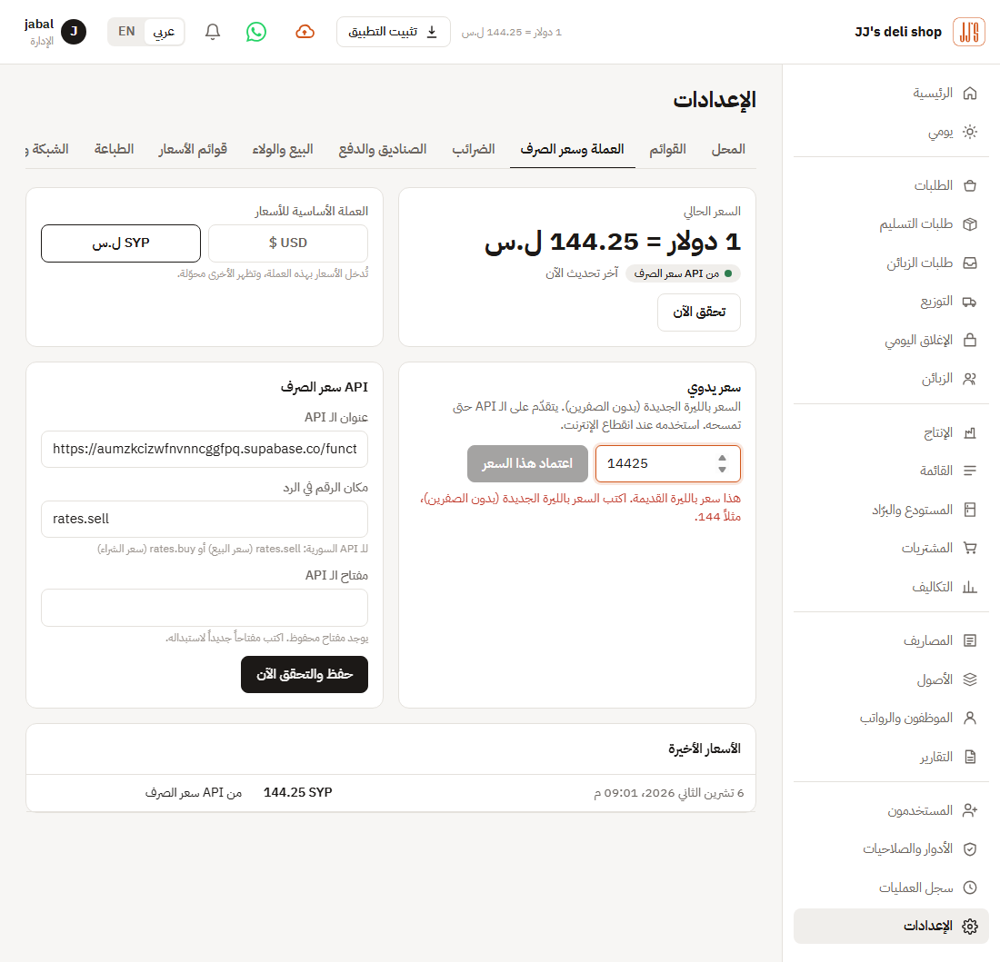

# Pre-handover QA report: JJ's ERP

**Verdict: Ready — small issues left** — 0 blocker, 0 major, 3 minor, 1 polish

All blockers and majors are fixed and re-tested on a fresh server: no double credit or double collection, Syrian-pound debts settle exactly, the live rate is in new pounds, and pounds products and suppliers save. Build, type check, all 9 API suites, the browser tour and the click-through flows pass. Two product questions stay open for the client (orders in fives, sample data).

| ID | Severity | Title | Status |
|---|---|---|---|
| QA-001 | Blocker | Return then cancel gives the client the money and the stock back twice | Fixed & verified |
| QA-002 | Blocker | A delivery collects money the client already paid at the shop | Fixed & verified |
| QA-018 | Blocker | A supplier or product in Syrian pounds could not be saved | Fixed & verified |
| QA-019 | Blocker | The rate API answers in old pounds; prices are in new pounds | Fixed & verified |
| QA-003 | Major | Syrian-pound debt paid in exact pounds still shows a small dollar debt | Fixed & verified |
| QA-004 | Major | Paying a supplier the exact Syrian-pound amount can leave a balance or be refused | Fixed & verified |
| QA-005 | Major | Closing a past day counts cash from later days as "short" | Fixed & verified |
| QA-006 | Major | Returns give back the wrong amount when the invoice had free items | Fixed & verified |
| QA-007 | Major | Changing or resetting a staff password does not sign that person out | Fixed & verified |
| QA-008 | Major | Cancelling a delivered order after the cash was handed over puts the driver's box negative | Fixed & verified |
| QA-009 | Minor | Assets page goes blank on refresh or direct link | Fixed & verified |
| QA-010 | Minor | Custom roles can see costs through the day summary and CSV export | Fixed & verified |
| QA-011 | Minor | Server libraries with known security fixes available | Fixed — needs re-test |
| QA-012 | Minor | Login has no per-IP limit and the server sends no security headers | Fixed & verified |
| QA-013 | Minor | A product photo can be an SVG file that runs script | Fixed & verified |
| QA-014 | Minor | Sample data cannot be removed once loaded | Fixed — needs re-test |
| QA-015 | Minor | Orders "in fives" also applies to walk-in, staff and tasting — but not to accepted portal requests | Needs your decision |
| QA-016 | Polish | "1 orders not delivered yet" — plural on the close screen | Fixed & verified |
| QA-017 | Polish | CSV cells starting with = + - @ are not neutralised | Fixed — needs re-test |

## QA-001 — Return then cancel gives the client the money and the stock back twice
*Blocker · Fixed & verified*

**Where:** Orders → Cancel / Distribution → Returns · admin, manager · en, ar · desktop, mobile · /orders
**Steps to reproduce:**
1. Make an order of 5 items on credit for a client ($9.50)
2. Distribution → **Returns**: return all 5 against that invoice, settlement **credit**
3. Cancel the same order
**Expected:** The cancel is refused (or only cancels what was not returned). The client ends at $0.
**Actual:** Cancel is accepted. Client balance went 0 → −9.50 → 0 → **+9.50** (free credit). Stock is added back twice. With a **refund** return, the cash box pays out twice.
**Likely cause:** `server/services/orders.ts:456-470` (`cancelOrder`) does not look at returns already recorded on the order. Reproduced: `qa/flows/money-bugs.mjs` step #1.
**Suggested fix:** Refuse cancel when the order has returns (message: "This invoice has returns — cancel the returns first"), or cancel only the not-returned part.
**Re-test:** Re-run in `qa/flows/retest.mjs` on a fresh server: cancel after a return is refused (409 order_has_returns, Arabic + English message); client balance stays 0.

## QA-002 — A delivery collects money the client already paid at the shop
*Blocker · Fixed & verified*

**Where:** Deliveries → collect money · admin, manager · en, ar · desktop, mobile · /deliveries
**Steps to reproduce:**
1. Make a delivery order on credit ($12.50)
2. Client pays $12.50 on their account (client page → **Record payment**)
3. Open **Deliveries**: the order still says $12.50 to collect
4. Tick delivered → **paid all**
**Expected:** The delivery shows nothing left to collect, because the client's debt is already paid.
**Actual:** The driver is told to collect $12.50 again; after collecting, the client is at **+$12.50** credit and the box has the money twice. The daily-close "did not pay" list has the same blind spot.
**Likely cause:** `orderRemaining` (`server/services/orders.ts:361`) only uses the order's own `paidAmount`; account payments (`server/routes/clients.ts:342`) are never linked to orders. Reproduced: `qa/flows/money-bugs.mjs` step #2.
**Suggested fix:** Cap what is left to collect by the client's real debt (never more than what they owe), or apply account payments to their oldest open invoices.
**Re-test:** Re-run in `qa/flows/retest.mjs` on a fresh server: after an account payment the Deliveries screen shows 0 to collect, the driver collects 0, balance stays 0. Same rule in the daily-close unpaid list. Invoice-tied payments now settle their own invoice first (`openClientCharges`, server/services/money.ts).

## QA-018 — A supplier or product in Syrian pounds could not be saved
*Blocker · Fixed & verified*

**Where:** Purchasing → Suppliers / Menu → Products · admin · en, ar · desktop, mobile
**Steps to reproduce:**
1. Add a supplier with currency SYP and no opening balance (or a product priced in SYP)
2. Save
**Expected:** It saves.
**Actual:** Refused with "Set the USD → SYP exchange rate first" — even when a rate was set. With prices in new pounds the menu could not be built.
**Likely cause:** `toUsd(0, "SYP", null)` threw: `server/routes/purchasing.ts:33` and `server/routes/menu.ts:197` passed no rate when the amount was 0.
**Suggested fix:** Converting 0 needs no rate (`server/lib/biz.ts`), and the supplier opening balance only asks for a rate when there is one.
**Re-test:** Re-run in `qa/flows/retest.mjs` on a fresh server: on a server with no rate at all, a SYP supplier and a SYP product both save (201).

## QA-019 — The rate API answers in old pounds; prices are in new pounds
*Blocker · Fixed & verified*

**Where:** Settings → Currency & rate · admin · en, ar · desktop
**Steps to reproduce:**
1. Connect the Syrian rate API
2. Sell a $3 item in SYP
**Expected:** About 433 new SYP.
**Actual:** The API gives 14,425 (old pounds); every SYP amount would have been 100× too big.
**Likely cause:** No handling of the 2026 redenomination (100 old = 1 new).
**Suggested fix:** Rates of 1,000 or more from the API are divided by 100 (`server/services/fx.ts`); the manual-rate box refuses old-pound numbers with a clear message.
**Re-test:** `qa/flows/fx-live.mjs` against the real API: 1 USD = 144.25 SYP; 5 × $3 salad = 2,165 SYP.

## QA-003 — Syrian-pound debt paid in exact pounds still shows a small dollar debt
*Major · Fixed & verified*

**Where:** Deliveries / client balance (SYP) · admin, manager · en, ar · desktop, mobile · /deliveries
**Steps to reproduce:**
1. Currency SYP, rate 13,000
2. Delivery order on credit: 146,250 SYP
3. Next rate 14,000
4. Deliver → **paid all** 146,250 SYP
**Expected:** The client owes 0.
**Actual:** Order says paid, but the client still owes **$0.80**; it shows in ageing, the money cloud and statements. The same happens for any SYP part payment when the rate moves.
**Likely cause:** Charge is valued at the order's rate, payment at today's rate (`server/services/orders.ts:348` vs `:413`, `:429`). Reproduced: `qa/flows/money-bugs.mjs` step #3.
**Suggested fix:** When a payment is in the same currency as the invoice, value it at the invoice's own rate (or keep SYP balances in SYP).
**Re-test:** Re-run in `qa/flows/retest.mjs` on a fresh server: 1,950 SYP order at 130, rate moved to 140, paid 1,950 SYP → balance exactly 0.

## QA-004 — Paying a supplier the exact Syrian-pound amount can leave a balance or be refused
*Major · Fixed & verified*

**Where:** Purchasing → pay supplier (SYP) · admin · en, ar · desktop · /purchasing/debts
**Steps to reproduce:**
1. Supplier invoice 1,000,000 SYP at rate 13,000
2. Rate changes
3. Supplier → **Pay** 1,000,000 SYP
**Expected:** The invoice is fully paid, nothing left.
**Actual:** After a rate rise, part of the invoice stays due (536,924 SYP was left in our test across two invoices). After a rate fall the code would refuse it as overpaid.
**Likely cause:** Same cause as QA-003: `server/services/wholesale.ts:313-333` (`paySupplier`) converts at today's rate while the due amount uses the purchase-day rate. Partly reproduced: `qa/flows/supplier-syp.mjs`.
**Suggested fix:** Same fix as QA-003 (settle same-currency payments in that currency).
**Re-test:** Re-run in `qa/flows/retest.mjs` on a fresh server: 10,000 SYP invoice paid with 10,000 SYP after the rate fell (130→120) and rose (140→150): accepted, nothing left due.

## QA-005 — Closing a past day counts cash from later days as "short"
*Major · Fixed & verified*

**Where:** Daily close · admin, manager · en, ar · desktop, mobile · /close
**Steps to reproduce:**
1. Leave yesterday open
2. Sell $100 cash today
3. Go back to yesterday and close it, typing the amount the screen shows
**Expected:** Difference 0.
**Actual:** The $100 from today is recorded as a cash difference on yesterday (found in code, not run — needs two calendar days).
**Likely cause:** `server/routes/days.ts:170` uses the whole box balance as expected; the screen (`days.ts:70-71,100`) uses opening + that day's moves.
**Suggested fix:** Use the same formula on save as on screen (moves up to that date), or only allow closing days in order.
**Re-test:** `qa/flows/close-past-day.mjs`: a $100 cash move dated tomorrow, today closed with the screen's amount → recorded difference 0.

## QA-006 — Returns give back the wrong amount when the invoice had free items
*Major · Fixed & verified*

**Where:** Distribution → Returns · admin, manager · en, ar · desktop · /distribution/returns
**Steps to reproduce:**
1. Invoice with 5 free items (loyalty or subscription) + 5 paid items at $3
2. Return the 5 free items
**Expected:** Nothing is credited for free items; returning the paid ones credits $15.
**Actual:** Free items are credited ($3.75) and paid ones under-credited ($11.25), because every unit gets the same share of the discount (found in code).
**Likely cause:** `server/services/wholesale.ts:103-105` uses one ratio `1 − discount/subtotal` for every line.
**Suggested fix:** Price each returned line from its own line total and free quantity.
**Re-test:** Re-run in `qa/flows/retest.mjs` on a fresh server: 5 free (loyalty) items returned → credit 0; 5 paid items → credit equals what was paid (16.25).

## QA-007 — Changing or resetting a staff password does not sign that person out
*Major · Fixed & verified*

**Where:** Users / Change password · admin · en, ar · desktop, mobile · /users
**Steps to reproduce:**
1. Sign in as member on phone A
2. Admin resets the member's password on Users
3. Use phone A
**Expected:** Phone A is signed out (as the client portal already does).
**Actual:** Phone A stays signed in for up to 30 days. A lost phone or a fired employee keeps access until the admin deactivates the user.
**Likely cause:** `server/routes/users.ts:108` and `server/routes/auth.ts:120` don't delete the user's sessions (portal does: `server/routes/clients.ts:601`).
**Suggested fix:** Delete that user's sessions on admin reset; on self-change keep only the current session.
**Re-test:** Re-run in `qa/flows/retest.mjs` on a fresh server: admin reset signs the old phone out (401); changing your own password keeps this device and signs the others out.

## QA-008 — Cancelling a delivered order after the cash was handed over puts the driver's box negative
*Major · Fixed & verified*

**Where:** Orders → Cancel / Daily close · admin, manager · en, ar · desktop · /orders
**Steps to reproduce:**
1. Driver collects $30 on a delivery
2. Close: hand the driver's cash to the main box
3. Cancel that order
**Expected:** The refund comes out of the box that now holds the money (main box), dated today.
**Actual:** The driver's box goes to −$30 and silently eats their next day's takings (found in code).
**Likely cause:** `server/services/orders.ts:464` reverses into the original box on the order's date.
**Suggested fix:** Reverse into the main box when the driver's cash was handed over; date it today.
**Re-test:** Re-run in `qa/flows/retest.mjs` on a fresh server: delivery cash handed in, then order cancelled → refund taken from the main box, driver box stays 0.

## QA-009 — Assets page goes blank on refresh or direct link
*Minor · Fixed & verified*

**Where:** Assets (الأصول) · admin · en, ar · desktop, mobile · /assets
**Steps to reproduce:**
1. Open **Assets** from the menu
2. Press refresh (or reopen the installed app on that page)
**Expected:** The Assets page loads again.
**Actual:** White page, HTTP 404, no menu.
**Likely cause:** The page URL `/assets` is the same as the folder for the app's built files (`server/app.ts:45-47`).
**Suggested fix:** Rename the page route to `/fixed-assets` (and its menu link), keep a redirect from the old link inside the app.
**Re-test:** Re-run in `qa/flows/retest.mjs` on a fresh server: page moved to /fixed-assets (200); old /assets links redirect there. UI tour passes.

## QA-010 — Custom roles can see costs through the day summary and CSV export
*Minor · Fixed & verified*

**Where:** Reports / Roles · custom role · en, ar · desktop · /reports
**Steps to reproduce:**
1. Make a custom role with **reports: export** (or dashboard view) but no **see costs**
2. Export the orders or products CSV
**Expected:** No cost or margin columns.
**Actual:** CSV has cost and margin; `/api/reports/five` returns goods cost and profit. Default Manager and Member are NOT affected.
**Likely cause:** `server/routes/reports.ts:131-195` and `server/services/reports.ts:383-387` don't check `see_cost`.
**Suggested fix:** Drop cost columns/kinds without `see_cost`; mask the five-answers costs like `/reports/day`.
**Re-test:** Re-run in `qa/flows/retest.mjs` on a fresh server: five-answers needs see-costs (manager → 403); CSV drops cost/margin columns without see-costs; purchases, supplier debts, expenses and withdrawals exports need their own module permission.

## QA-011 — Server libraries with known security fixes available
*Minor · Fixed — needs re-test*

**Where:** Dependencies
**Steps to reproduce:**
1. Run `npm audit --omit=dev`
**Expected:** No high issues.
**Actual:** 4 high: body-parser, compression, on-headers (fix with `npm audit fix`, no breaking change); drizzle-orm and zod need a major upgrade (low real risk here: no user-built SQL identifiers).
**Suggested fix:** Run `npm audit fix`, rebuild, run `npm test`. Leave drizzle/zod majors for later.
**Re-test:** `npm audit fix`: body-parser, compression and on-headers updated (5 → 2 advisories). drizzle-orm and zod need major upgrades: left for later, they don't apply to how the app uses them.

## QA-012 — Login has no per-IP limit and the server sends no security headers
*Minor · Fixed & verified*

**Where:** Security (online server)
**Steps to reproduce:**
1. Try 5 wrong passwords for `jabal`
**Expected:** The attacker is slowed, not the real admin.
**Actual:** The real admin is locked out for 60s, repeatably; one password can be tried against many usernames freely. No nosniff / frame / referrer headers.
**Likely cause:** `server/lib/auth.ts:110-127` locks per username in memory; `server/app.ts` adds no headers.
**Suggested fix:** Add per-IP rate limit on `/auth/login` and `/portal/login`; add basic security headers (helmet).
**Re-test:** Re-run in `qa/flows/retest.mjs` on a fresh server: nosniff / frame / referrer headers present; 20 wrong logins from one address in 10 min block that address for 10 min (per-username 60s lock kept).

## QA-013 — A product photo can be an SVG file that runs script
*Minor · Fixed & verified*

**Where:** Menu → product photo
**Steps to reproduce:**
1. Upload an SVG with script as a product photo (needs menu create — admin only)
**Expected:** Only PNG/JPEG/WebP accepted.
**Actual:** Any `data:image/...` accepted and served from the app's own address.
**Likely cause:** `server/routes/menu.ts:130` and photo routes `menu.ts:278-282`, `portal.ts:201-205`.
**Suggested fix:** Allow png/jpeg/webp only; send `X-Content-Type-Options: nosniff`.
**Re-test:** Re-run in `qa/flows/retest.mjs` on a fresh server: saving an SVG product photo → 400; photo routes only serve PNG/JPEG/WebP/GIF.

## QA-014 — Sample data cannot be removed once loaded
*Minor · Fixed — needs re-test*

**Where:** Settings → Network & cloud → Load sample data
**Steps to reproduce:**
1. Load sample data on the live server to try things
2. Try to start fresh
**Expected:** A way to clear sample data before going live.
**Actual:** No clear/reset; sample clients, products and stock stay in reports.
**Suggested fix:** Either hide the button on the online server, or add **Remove sample data** (only before the first real order). Tell the client not to press it on the live server.
**Re-test:** Docker image sets JJS_ONLINE=1: the Load sample data card is hidden there and the server refuses it (403). Laptop copies keep it. Not run under Docker here.

## QA-015 — Orders "in fives" also applies to walk-in, staff and tasting — but not to accepted portal requests
*Minor · Needs your decision*

**Where:** New order / Client requests
**Steps to reproduce:**
1. New order → Walk-in → try 1 salad
2. Portal request with qty 7 → accept
**Expected:** Rule as the client wants it.
**Actual:** Walk-in, staff purchase and tasting must be 5, 10, 15…; a portal request for 7 is accepted as 7.
**Likely cause:** `shared/orderQty.ts` applied to every staff order; `server/services/portal.ts:75` skips the check.
**Suggested fix:** Ask the client which order types the fives rule is for, then apply it the same everywhere.

## QA-016 — "1 orders not delivered yet" — plural on the close screen
*Polish · Fixed & verified*

**Where:** Daily close · /close
**Suggested fix:** Use singular for 1 (English).
**Re-test:** Close screen uses "1 order" / "2 orders" in English (4 places). Arabic was already right.

## QA-017 — CSV cells starting with = + - @ are not neutralised
*Polish · Fixed — needs re-test*

**Where:** Reports → CSV
**Likely cause:** `server/routes/reports.ts:128`
**Suggested fix:** Prefix such cells with an apostrophe.
**Re-test:** CSV text cells starting with = + - @ get a leading apostrophe; numbers stay numbers.

## Checked and working
- Re-tests of every fixed finding (`qa/flows/retest.mjs`, `close-past-day.mjs`, `fx-live.mjs`) — all pass
- Browser tour of every screen (tests/ui-tour.py) and click-through flows (tests/ui-flows.py) after the fixes
- Type check, production build and all 9 API suites (smoke, full day, sync, wholesale, portal, day & route, money, manager, member, deliveries)
- First start online: admin, manager and member created from env variables; no open setup page
- All screens for Admin, Manager, Member and portal client in Arabic and English on desktop and phone — no page errors, no failed requests (except QA-009)
- Arabic is right-to-left everywhere with Arabic dates; phone layouts fit 390px with no sideways scrolling
- Member blocked from every forbidden page by URL; manager blocked from users, roles, audit, settings, costing, purchasing, people
- Portal clients only see their own orders, requests and notifications; portal and staff logins are separate
- Discounts: % capped at 100, amount can't push a total below 0, members can't give discounts
- Double deliver and double cancel are refused; quantity 0 and negatives refused
- Part payment on an invoice puts the rest on the client's account correctly
- Order, purchase and return numbers are unique; server runs on Damascus time (Dockerfile TZ)
- No secrets in the repo or the web bundle; Supabase and rate-API keys never sent to the browser or audit log
- CSV exports open in Excel with Arabic (UTF-8 BOM)
- Deep links work after refresh (except /assets); unknown API routes give a clean 404 message
- Backups restore only by exact backup name (no path tricks)
